# PriceForge Security Testing Lab Guide

> **DISCLAIMER & PURPOSE**  
> PriceForge is an educational web application designed for authorized local web security testing, penetration testing training, and defensive security engineering. All vulnerabilities are controlled, isolated, and intended strictly for execution within a local development environment.

---

## Lab User Accounts

| Role | Email | Password | Intended Usage |
|------|-------|----------|----------------|
| **Administrator** | `admin@priceforge.local` | `Admin123!` | Admin dashboard, inventory management, product uploads |
| **Customer 1** | `alex@priceforge.local` | `Customer123!` | Primary customer testing, order placement, reviews |
| **Customer 2** | `sam@priceforge.local` | `Customer123!` | Secondary customer for cross-account IDOR validation |

---

## Index of Documented Vulnerabilities

1. [Client-Side Price Manipulation](#1-client-side-price-manipulation)
2. [Insecure Direct Object Reference (IDOR) — Order Details](#2-insecure-direct-object-reference-idor--order-details)
3. [Insecure Direct Object Reference (IDOR) — Address Deletion](#3-idor--customer-address-deletion)
4. [Insecure Direct Object Reference (IDOR) — Wishlist Item Removal](#4-idor--wishlist-item-removal)
5. [Broken Access Control — Unprotected Administrative Metrics API](#5-broken-access-control--unprotected-administrative-api)
6. [SQL Injection — Product Search Lab](#6-sql-injection--product-search-lab)
7. [Stored Cross-Site Scripting (XSS) — Product Reviews](#7-stored-cross-site-scripting-xss--product-reviews)
8. [Reflected Cross-Site Scripting (XSS) — Search Results](#8-reflected-cross-site-scripting-xss--search-results)
9. [Cross-Site Request Forgery (CSRF) — Account Profile Update](#9-cross-site-request-forgery-csrf--profile-update)
10. [Information Disclosure & Weak Token Handling — Password Reset](#10-weak-password-reset-token-handling--response-disclosure)
11. [Insecure File Upload — Admin Product Image](#11-insecure-file-upload--admin-product-management)
12. [Business Logic Flaws — Coupon Reuse & Subtotal Validation](#12-business-logic-flaws--coupon-validation)

---


## 1. Client-Side Price Manipulation

**What are we testing?**

We want to find out if a customer can change a product's price before placing an order.

For example, a pair of headphones costs ₦45,000. Can we change the price to ₦10 and successfully place the order for that amount?

**Affected Endpoint:** `POST /orders/checkout`

**Required Account:** Logged-in customer (`customer`).

### Testing Steps

**Step 1: Log in and add a product to your cart.**

Log in using the test customer account:

- Email: `alex@priceforge.local`
- Password: Use the password configured for this account.

Add a product to your cart. For this test, we will use the Wireless Headphones, which cost ₦45,000.


**Step 2: Open the checkout page.**

Navigate to:

`http://localhost:3000/orders/checkout`

You should see your selected product and its original price.

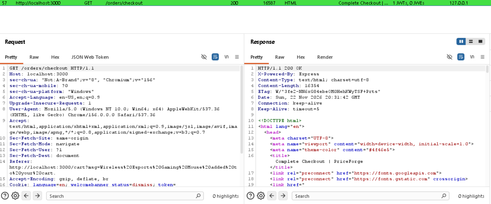

**Step 3: Find the hidden price field.**

We need to find the price that the browser sends to the server when you place an order.

Follow these instructions:

1. Right-click anywhere on the checkout page.
2. Select **Inspect**.
3. Open the **Elements** tab.
4. Press `Ctrl + F`.
5. Search for `items[0][price]`.

You should find something similar to this:

```html
<input type="hidden"
       name="items[0][price]"
       value="45000">
```

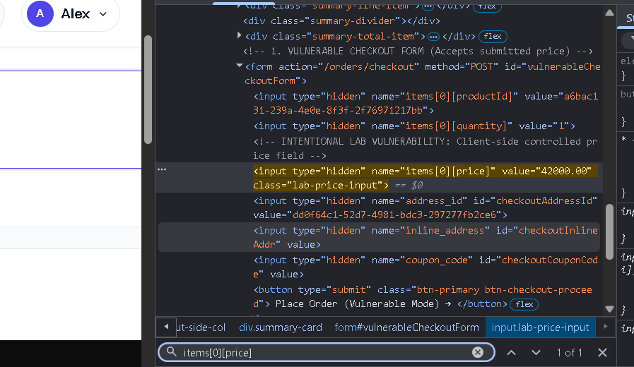

**What are you looking at?**

- `type="hidden"` means this field is not normally visible on the checkout page.
- `name="items[0][price]"` identifies the price being sent to the server.
- `value="45000"` is the original price being submitted.

Even though this field is hidden, a customer can still change its value using the browser's developer tools.

**Step 4: Change the product price.**

Now let's change the price from ₦45,000 to ₦10.

1. Double-click the number `45000` beside `value`.
2. Replace it with `10`.
3. Press Enter.

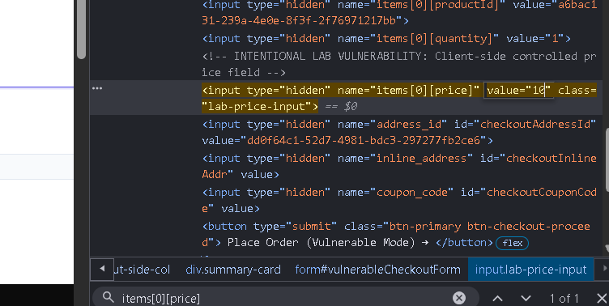

**Step 5: Place the order.**

Important: You will notice that the displayed price on the checkout page has not changed. Don't worry; this is expected.

We changed the hidden price field, not the amount displayed on the page.

Now click **Place Order** to submit your order.

**Step 6: Check your order history.**

After the order is successfully placed:

1. Open **My Orders**.
2. Find the order you just created.
3. Open the order details.
4. Check the total amount.

If the vulnerability works, you should see that the order was created for ₦10 instead of the original ₦45,000.

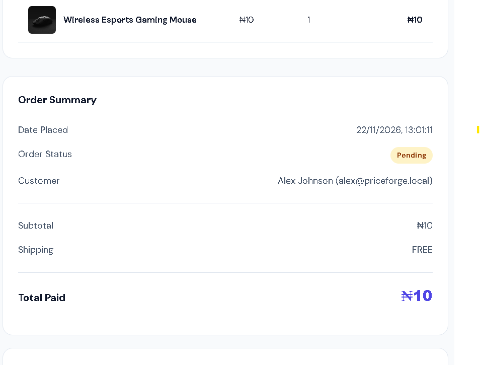

### Expected Vulnerable Behavior

The application accepts the price submitted by the customer instead of checking the actual product price stored in the database.

As a result, the order is saved with the manipulated amount.

### Security Impact

An attacker could change product prices before checkout, causing the business to lose money while still processing orders and reducing product stock.

### How to Fix It

The server should always get product prices directly from the database instead of trusting prices submitted by the browser.

See [SECURITY-FIXES.md — Fix #1](SECURITY-FIXES.md#1-remediation-price-manipulation).

PriceForge also includes a secure checkout implementation at:

`POST /orders/checkout-secure`

---


## 2. Insecure Direct Object Reference (IDOR) — Order Details

**What are we testing?**

We want to find out if one customer can view another customer's private order without permission.

For example, Alex places an order with ID `15`. Sam logs into his own account and changes the order number in the URL to `15`.

Can Sam see Alex's order even though it does not belong to him?

If yes, we have an IDOR vulnerability.

**Affected Endpoint:** `GET /orders/:id`

**Required Account:** Two authenticated customer accounts.

### Testing Steps

**Step 1: Log in as Customer 1 (Alex).**

Log in using:

- Email: `alex@priceforge.local`
- Password: Use the password configured for this account.

Open **My Orders** and select one of Alex's orders.
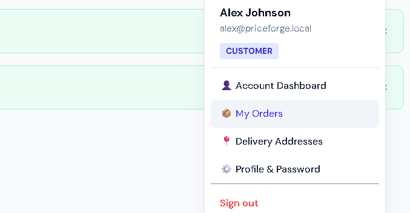


Look at the browser URL and record the numeric order ID.

For example:

`http://localhost:3000/orders/15`

Here, `15` is Alex's order ID.


**Step 2: Log in as Customer 2 (Sam).**

1. Log out of Alex's account.
2. Log in using Sam's account:

   - Email: `sam@priceforge.local`
   - Password: Use the password configured for this account.

Make sure you are now logged in as Sam.

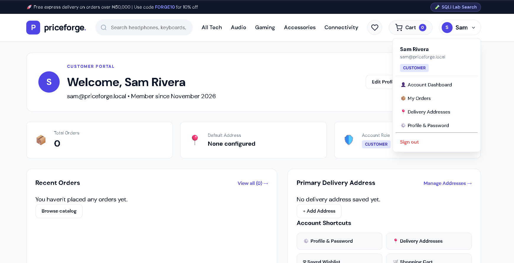

**Step 3: Try accessing Alex's order.**

While logged in as Sam, open a new browser tab.


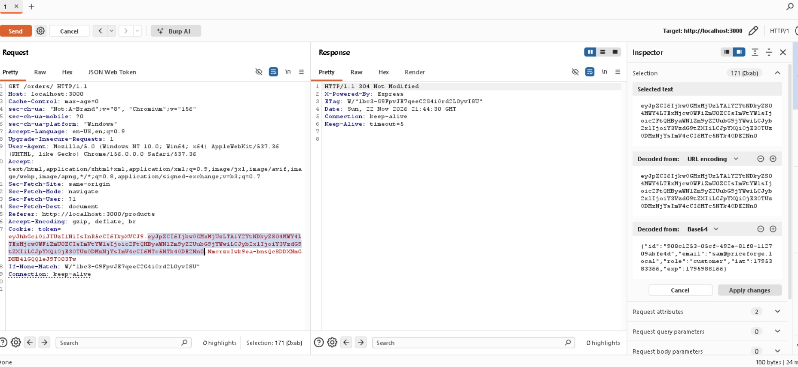


Enter Alex's order URL:

`http://localhost:3000/orders/6` or 3
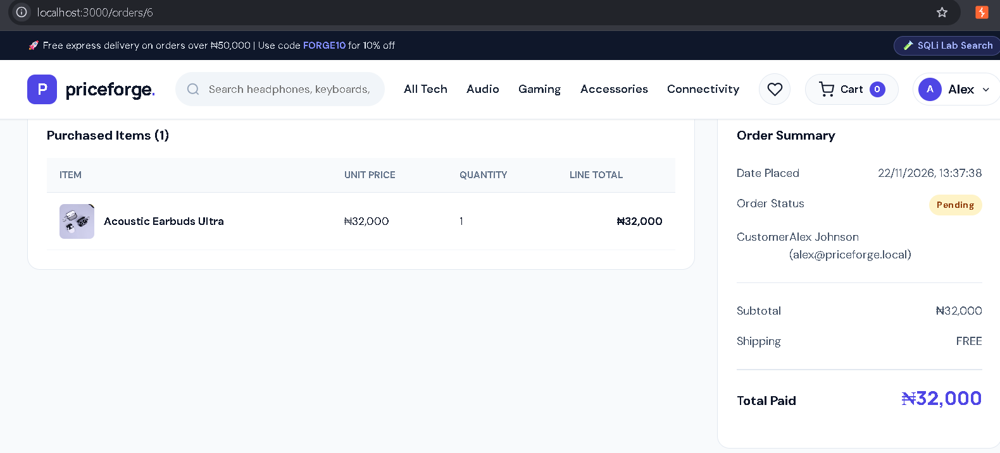

Replace (id)`6` or `3` with the actual order ID you recorded from Alex's account.

Press Enter.

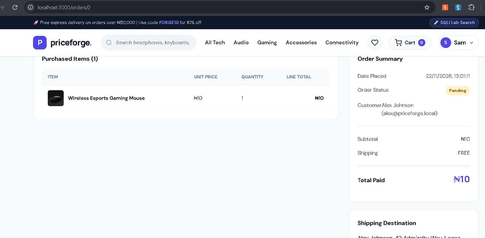

HOW TO CHECK WITH BURP SUITE
1. look for your GET orders request


2. Right click and send to repeater tab

3. On repeater tab, send the request


4. Modify the GET request to GET /orders/id, using Alex's order ID, im using ID 3 for example (Make sure Alex's have an order)


**Step 4: Check what happens.**

If the vulnerability works, Sam will be able to see Alex's order even though he is logged into a completely different account.

Check whether the page displays:

- Alex's order number.
- Products Alex purchased.
- Order total.
- Recipient name and delivery address, if available.

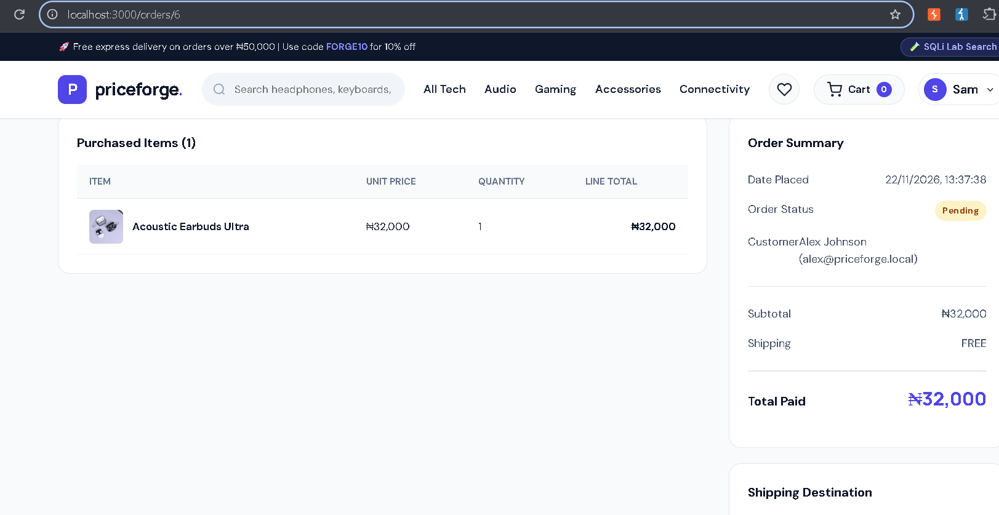

### Expected Vulnerable Behavior

Sam successfully views Alex's order by entering Alex's numeric order ID in the URL.

The application checks whether the order exists but fails to check whether the order belongs to the currently logged-in customer.

### Security Impact

An attacker could access other customers' private order information, purchase history and personal delivery details.

### How to Fix It

The server must check both the order ID and the ID of the currently logged-in customer before displaying order details.

See [SECURITY-FIXES.md — Fix #2](SECURITY-FIXES.md#2-remediation-idor-orders).

PriceForge also provides a secure reference endpoint:

`GET /orders/secure/:id`

---


## 3. IDOR — Customer Address Deletion

**What are we testing?**

We want to find out if one customer can delete another customer's saved delivery address without permission.

For example, Sam saves his home address in his account. Alex logs into his own account and tries to delete Sam's address.

If Alex can delete it, we have an IDOR vulnerability.

**Affected Endpoint:** `POST /account/addresses/:id/delete-insecure`

**Required Account:** Two authenticated customer accounts.

### Testing Steps

**Step 1: Log in as Customer 2 (Sam).**

Log in using:

- Email: `sam@priceforge.local`
- Password: Use the password configured for this account.

Navigate to your account's address management page.

Create a new delivery address. You can use fictional test information.


**Step 2: Find Sam's address ID.**

Look at the address card you just created.

Find and copy its address ID. The application may display it on the card or in the page's HTML.

For example:

`Address ID: 12`

Keep this ID. We will use it to test whether another customer can delete the address.


**Step 3: Log in as Customer 1 (Alex).**

1. Log out of Sam's account.
2. Log in using:

   - Email: `alex@priceforge.local`
   - Password: Use the password configured for this account.

You should now be logged in as Alex.


**Step 4: Try deleting Sam's address.**

While logged in as Alex, send a POST request to:

`/account/addresses/12/delete-insecure`

Replace `12` with Sam's actual address ID.

You can use Burp Suite Repeater:

1. Intercept or capture a request to delete one of Alex's own test addresses.
2. Send the request to Repeater.
3. Change the URL to Sam's address ID.
4. Keep Alex's authenticated session.
5. Send the request.


**Step 5: Check whether Sam's address was deleted.**

Log out of Alex's account and log back in as Sam.

Open the address management page.

If the vulnerability works, Sam's delivery address will have disappeared even though Sam never authorized Alex to delete it.


### Expected Vulnerable Behavior

Alex successfully deletes an address belonging to Sam by submitting Sam's address ID.

The application deletes the address without checking whether it belongs to the currently logged-in customer.

### Security Impact

An attacker could delete other customers' saved delivery addresses without permission. This could disrupt deliveries and allow unauthorized changes to customer data.

### How to Fix It

The server must check that the address belongs to the currently logged-in customer before deleting it.

See [SECURITY-FIXES.md — Fix #3](SECURITY-FIXES.md#3-remediation-idor-addresses).

PriceForge also provides a secure reference endpoint:

`POST /account/addresses/:id/delete`

---

### 4. IDOR — Wishlist Item Removal

- **Vulnerability Name:** Insecure Direct Object Reference on Saved Wishlist Items
- **Affected Endpoint:** `POST /wishlist/item/:id/remove-insecure`
- **Required Account:** Any Authenticated Customer
- **Description:**  
  The controller invokes `removeWishlistItemInsecure(id)` with a direct SQL query `DELETE FROM wishlist_items WHERE id = $1` omitting a user identifier check.
- **Verification & Analysis Steps:**
  1. Sign in as Customer 1 and add an item to the wishlist.
  2. Locate the `wishlist_item_id`.
  3. Submit a POST request as Customer 2 to `/wishlist/item/<Item-ID>/remove-insecure`.
- **Expected Vulnerable Behavior:**  
  Customer 1's saved wishlist item is deleted by Customer 2.
- **Security Impact:**  
  Unauthorized cross-account data modification.
- **Remediation Reference:**  
  See [SECURITY-FIXES.md — Fix #4](SECURITY-FIXES.md#4-remediation-idor-wishlist).

---

### 5. Broken Access Control — Unprotected Administrative API

- **Vulnerability Name:** Missing Function-Level Access Control on Administrative API
- **Affected Endpoint:** `GET /admin/api/unprotected-stats`
- **Required Account:** Unauthenticated (Public / Guest)
- **Description:**  
  The route handler for `/admin/api/unprotected-stats` is mounted on the router prior to the `requireAdmin` middleware. It executes administrative database aggregations and returns customer email records and revenue data.
- **Verification & Analysis Steps:**
  1. Open a browser or terminal without any authentication cookies.
  2. Send a GET request to `http://localhost:3000/admin/api/unprotected-stats`.
- **Expected Vulnerable Behavior:**  
  The server responds with HTTP 200 and a JSON payload containing live operational statistics and a sample of user accounts and roles.
- **Security Impact:**  
  Privilege escalation, reconnaissance disclosure of system metrics, and enumeration of administrator and user email accounts.
- **Remediation Reference:**  
  See [SECURITY-FIXES.md — Fix #5](SECURITY-FIXES.md#5-remediation-broken-access-control).

---

## 6. SQL Injection — Product Search

**What are we testing?**

We want to find out if PriceForge safely handles what we type into the product search.

Normally, the application should treat our search input as ordinary text. But if the backend joins our input directly into an SQL query, we may be able to change how the database understands that query.

This is called **SQL Injection (SQLi)**.

**Affected Endpoint:** `GET /products/search/vulnerable?q=<search-term>`

**Required Account:** None. Anyone can access this endpoint.

### Testing Steps

**Step 1: Open the vulnerable search endpoint.**

Open your browser and visit:

`http://localhost:3000/products/search/vulnerable?q=test`

The application should search for products containing the word `test`.

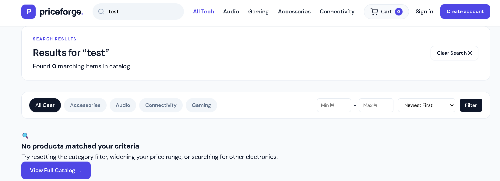

**Step 2: Test how the application handles a quote.**

Now visit:

`http://localhost:3000/products/search/vulnerable?q=test%27`
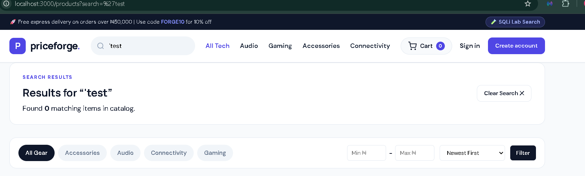

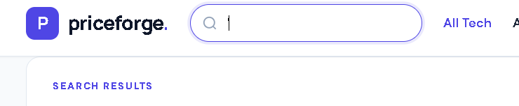

The `%27` represents a single quote (`'`).

A single quote can affect how SQL statements are written. If the application does not handle it safely, the database may return an error.

Look at the response.

If the page displays a PostgreSQL syntax error or database error details, take note.


**Step 3: Test whether the search query can change the SQL logic.**

In your local lab, try this query:

`http://localhost:3000/products/search/vulnerable?q=test%25%27%20OR%201%3D1--`

This represents the search input:

`test%' OR 1=1--`

The expression `1=1` is always true. The `--` begins a SQL comment in PostgreSQL, which can cause the remaining part of the query to be ignored.

Observe the results returned by PriceForge.


**Step 4: Compare with the secure search.**

Now use the normal product search:

`http://localhost:3000/products?search=test`

The secure search should treat your input as a search term, not as part of an SQL command.


### Expected Vulnerable Behavior

The vulnerable endpoint directly inserts the user's search input into the SQL query.

This may cause database errors or allow the search condition to return products that do not match the original search term.

### Security Impact

SQL Injection can allow attackers to interfere with database queries. Depending on the database permissions and the vulnerable query, this may expose or modify information stored in the database.

### How to Fix It

Use parameterized SQL queries instead of joining user input directly into the SQL statement.

For example, PostgreSQL supports placeholders such as `$1`.

See [SECURITY-FIXES.md — Fix #6](SECURITY-FIXES.md#6-remediation-sql-injection).

The normal `/products` search in PriceForge uses parameterized queries as the secure reference.

### 7. Stored Cross-Site Scripting (XSS) — Product Reviews

- **Vulnerability Name:** Stored XSS in Product Review Comments
- **Affected Endpoint:** View: `GET /products/:id` | Submit: `POST /products/:id/reviews`
- **Required Account:** Authenticated Customer
- **Description:**  
  In `views/shop/product-details.ejs`, review comments are output to the DOM using EJS unescaped syntax:
  `<%- rev.comment %>`
  User input stored in the `reviews` table is emitted without HTML entity encoding.
- **Verification & Analysis Steps:**
  1. Sign in as Customer 1.
  2. Navigate to any product page and scroll to "Write a Review".
  3. Submit a review containing HTML elements (e.g., `<b>Bold Text Review</b>` or ``).
  4. Reload the page.
- **Expected Vulnerable Behavior:**  
  The submitted HTML tags execute in the browser context of any visitor viewing the product reviews.
- **Security Impact:**  
  Session hijacking via cookie theft (if HttpOnly is misconfigured), arbitrary DOM manipulation, and credential harvesting.
- **Remediation Reference:**  
  See [SECURITY-FIXES.md — Fix #7](SECURITY-FIXES.md#7-remediation-stored-xss). Replace `<%- rev.comment %>` with `<%= rev.comment %>`.

---

### 8. Reflected Cross-Site Scripting (XSS) — Search Results

## 4. Reflected Cross-Site Scripting (XSS) — Product Search

**What are we testing?**

We want to find out whether PriceForge displays what we type into the search box as plain text or treats it as HTML.

For example, if we search for a word wrapped in HTML tags, does the browser display the tags as text, or does it interpret them?

If the browser interprets the HTML, we may have a Reflected XSS vulnerability.

**Affected Endpoint:** `GET /products?search=<search-term>`

**Required Account:** None. Anyone can access the product search page.

### Testing Steps

**Step 1: Open the product search page.**

Visit:

`http://localhost:3000/products`

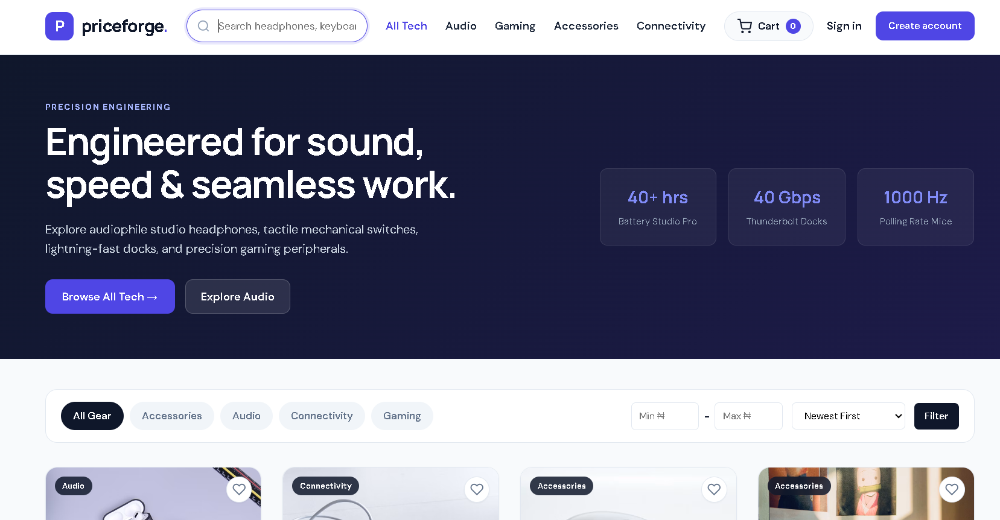

**Step 2: Enter a harmless HTML test.**

In the browser's address bar, open this URL:

`http://localhost:3000/products?search=%3Cu%3EReflected-Test%3C%2Fu%3E`

This is the URL-encoded version of:

`<u>Reflected-Test</u>`

The HTML tags are intended to underline the text.

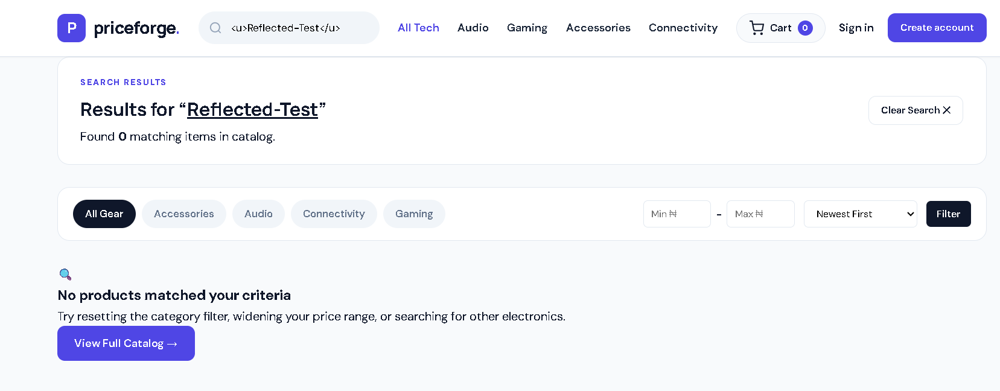

**Step 3: Observe the search heading.**

Look at the search results heading.

If the vulnerability exists, the word `Reflected-Test` should appear underlined because the browser interpreted the HTML tags.

You can also right-click the heading and select **Inspect** to examine how the browser rendered it.

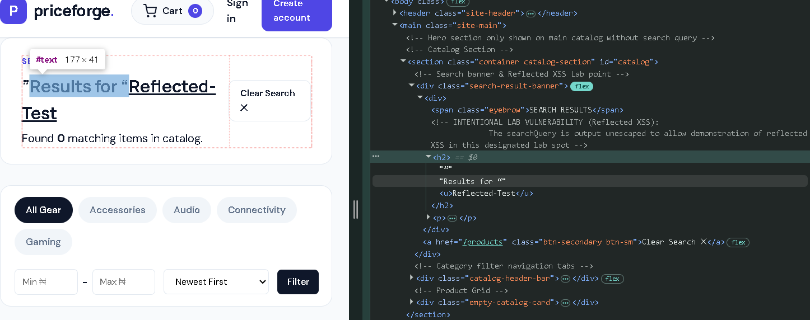

### Expected Vulnerable Behavior

The application displays the search query using raw, unescaped output.

In `views/shop/products.ejs`, the vulnerable code looks like this:

```ejs
<h2>Results for “<%- searchQuery %>”</h2>
```

The `<%- ... %>` syntax in EJS outputs the value without HTML escaping.

This allows user-supplied HTML to be interpreted by the browser.

### Security Impact

If an attacker creates a malicious search link and convinces someone to open it, the page may execute attacker-controlled JavaScript in the victim's browser.

This can lead to phishing, unwanted actions performed in the victim's session, or exposure of information accessible to the page.

### How to Fix It

Use EJS's escaped output syntax:

```ejs
<h2>Results for “<%= searchQuery %>”</h2>
```

The `<%= ... %>` syntax escapes HTML characters so the browser displays the input as text instead of interpreting it as markup.

See [SECURITY-FIXES.md — Fix #8](SECURITY-FIXES.md#8-remediation-reflected-xss).

---

### 9. Cross-Site Request Forgery (CSRF) — Profile Update

- **Vulnerability Name:** Missing Anti-CSRF Token on State-Changing Action
- **Affected Endpoint:** `POST /account/profile`
- **Required Account:** Authenticated Customer
- **Description:**  
  The user profile update form accepts changes to the customer's name and email address via POST. The endpoint does not require or validate anti-CSRF tokens, relying solely on cookies.
- **Verification & Analysis Steps:**
  1. Authenticate as a customer in the browser.
  2. Create a local HTML file containing an auto-submitting form targeting `http://localhost:3000/account/profile` with new name and email values.
  3. Open the file in the same browser session.
- **Expected Vulnerable Behavior:**  
  The profile information is updated without the user's explicit interaction on the application site.
- **Security Impact:**  
  Account state modification and unauthorized email redirection.
- **Remediation Reference:**  
  See [SECURITY-FIXES.md — Fix #9](SECURITY-FIXES.md#9-remediation-csrf).

---

### 10. Weak Password Reset Token Handling & Response Disclosure

- **Vulnerability Name:** Password Reset Token Leakage in HTTP Response
- **Affected Endpoint:** `POST /auth/forgot-password`
- **Required Account:** Public / Unauthenticated
- **Description:**  
  To facilitate local testing without external email infrastructure, the password reset controller generates a token and renders it directly in the HTML response alongside a clickable link.
- **Verification & Analysis Steps:**
  1. Navigate to `/auth/forgot-password`.
  2. Enter any valid user email (e.g. `alex@priceforge.local`) and submit.
  3. Inspect the response page and source.
- **Expected Vulnerable Behavior:**  
  The generated reset token and direct reset link are displayed in the response body.
- **Security Impact:**  
  Account takeover without mailbox access.
- **Remediation Reference:**  
  See [SECURITY-FIXES.md — Fix #10](SECURITY-FIXES.md#10-remediation-password-reset).

---

### 11. Insecure File Upload — Admin Product Management

- **Vulnerability Name:** Unrestricted Product Image File Upload
- **Affected Endpoint:** `POST /admin/products/new` and `POST /admin/products/:id/edit`
- **Required Account:** Administrator (`admin`)
- **Description:**  
  The Multer file storage configuration accepts arbitrary file extensions, generates a unique filename preserving the original extension, and saves the file in `public/uploads/`. It does not validate MIME types against magic bytes.
- **Verification & Analysis Steps:**
  1. Sign in as `admin@priceforge.local` and go to `/admin/products/new`.
  2. Upload a file with an unexpected extension (e.g. `.svg`, `.html`, or `.txt`).
  3. Save the product and check `public/uploads/`.
- **Expected Vulnerable Behavior:**  
  The uploaded file is stored verbatim in the publicly accessible uploads directory.
- **Security Impact:**  
  Stored XSS (via `.svg` or `.html`), server storage exhaustion, or cross-site content hosting.
- **Remediation Reference:**  
  See [SECURITY-FIXES.md — Fix #11](SECURITY-FIXES.md#11-remediation-file-upload).

---

### 12. Business Logic Flaws — Coupon Validation

- **Vulnerability Name:** Business Logic Inconsistencies in Coupon Redemption
- **Affected Endpoint:** `POST /orders/api/apply-coupon` and `POST /orders/checkout`
- **Required Account:** Authenticated Customer
- **Description:**  
  Coupons enforce minimum order values and usage limits, but client-side price alterations can cause discounts to exceed modified subtotals if not re-evaluated during final checkout calculation.
- **Verification & Analysis Steps:**
  1. Add items to reach ₦30,000 and apply coupon `FLAT5000`.
  2. Alter item prices or quantities during checkout submission to drop subtotal below ₦5,000.
  3. Inspect the final total computation.
- **Expected Vulnerable Behavior:**  
  The discount logic clamps the subtotal to ₦0.00 but permits anomalous discount application relative to actual item costs.
- **Security Impact:**  
  Financial exploitation and circumvention of promotional business rules.
- **Remediation Reference:**  
  See [SECURITY-FIXES.md — Fix #12](SECURITY-FIXES.md#12-remediation-business-logic).
